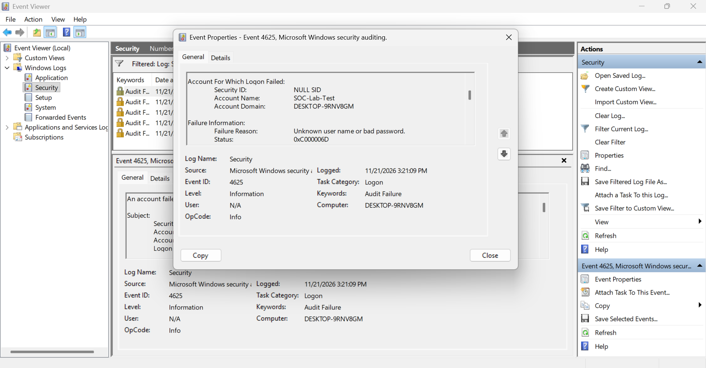
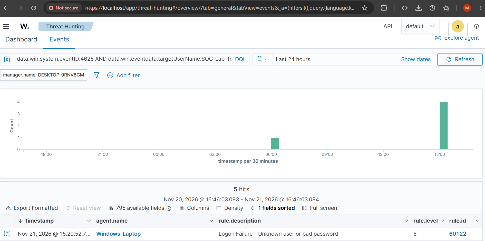
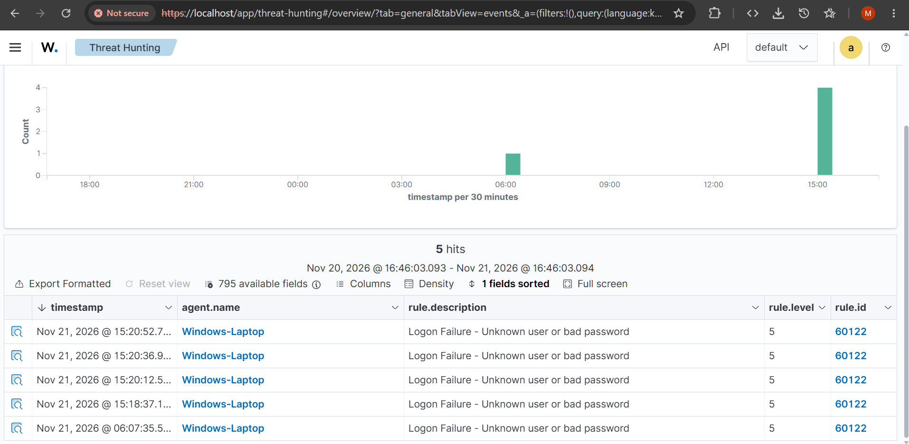
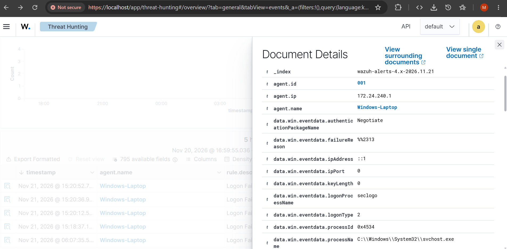
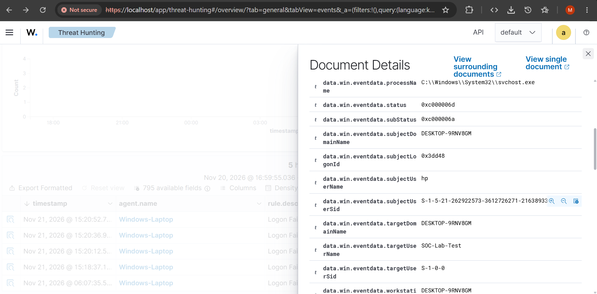
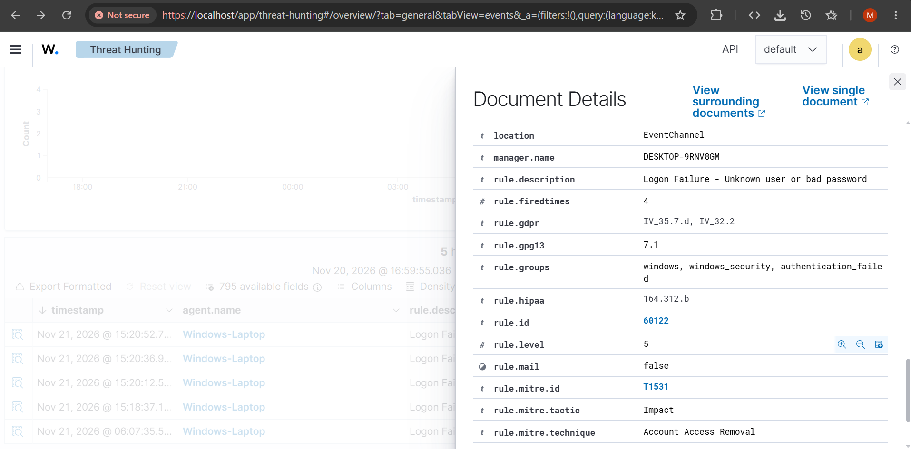

# SOC Practical Lab 02: Brute-Force Attack Detection and Investigation

**Role:** Aspiring Tier 1 SOC Analyst  
**Project Type:** Blue Team / Security Monitoring  
**Tools:** Windows 11, Windows Event Viewer, Wazuh SIEM  
**Status:** Investigation Completed

---

## 1. Project Overview

This project demonstrates a controlled simulation of repeated failed authentication attempts against a local Windows test account.

The objective was to generate multiple failed login events, investigate the resulting Windows Security logs, and verify whether Wazuh SIEM successfully detected and generated alerts for the activity.

The investigation focuses on identifying repeated authentication failures, examining relevant event details, and documenting the findings from a SOC Analyst perspective.

## 2. Investigation Objectives

- Generate five controlled failed login attempts against a test account.
- Identify Windows Security Event ID 4625.
- Examine authentication failure details.
- Investigate the events using Wazuh SIEM.
- Verify Wazuh alert generation and detection.
- Analyse the source address and targeted account.
- Document the investigation and findings.

## 3. Investigation Environment

| Component | Configuration |
|---|---|
| Endpoint | Windows workstation |
| SIEM | Wazuh |
| Wazuh Agent | Windows-Laptop |
| Test Account | SOC-Lab-Test |
| Windows Event ID | 4625 |
| Wazuh Rule ID | 60122 |
| Wazuh Alert Level | 5 |

## 4. Controlled Attack Simulation

Five intentionally incorrect password attempts were made against the local test account `SOC-Lab-Test` using the Windows `runas` command.

Each attempt returned Windows error code `1326`, indicating that the username or password was incorrect.

The purpose was to simulate repeated authentication failures in a controlled laboratory environment.

**Simulation Result:** Five failed authentication attempts generated successfully.

## 5. Windows Event Log Investigation

Windows Security logs recorded five Event ID 4625 events corresponding to the controlled failed login attempts.

### 5.1 Event Findings

| Field | Observed Value |
|---|---|
| Event ID | 4625 |
| Target Account | SOC-Lab-Test |
| Logon Type | 2 |
| Failure Reason | Unknown user name or bad password |
| Status | 0xC000006D |
| SubStatus | 0xC000006A |
| Source Network Address | ::1 |

### 5.2 Initial Analysis

Event ID 4625 indicates a failed logon attempt.

The status code `0xC000006D` represents a logon failure, while substatus `0xC000006A` indicates an incorrect password.

The source address `::1` is the IPv6 loopback address, indicating a local authentication attempt rather than an external network source.

## 6. Wazuh SIEM Investigation

The Windows endpoint successfully transmitted the five failed authentication events to the Wazuh SIEM.

Wazuh generated alerts for all five events.

### 6.1 Wazuh Detection Results

| Field | Observed Value |
|---|---|
| Total Events Detected | 5 |
| Windows Event ID | 4625 |
| Wazuh Rule ID | 60122 |
| Wazuh Alert Level | 5 |
| Target Account | SOC-Lab-Test |
| Source Address | ::1 |
| Wazuh Agent | Windows-Laptop |

**Wazuh Rule Description:** Logon Failure - Unknown user or bad password.

### 6.2 Detection Analysis

Wazuh successfully detected all five failed authentication events generated during the controlled simulation.

The SIEM assigned Rule ID 60122 and alert level 5 to the events.

The results demonstrate successful collection and alerting of repeated Windows authentication failures.

## 7. Investigation Screenshots

### 7.1 Windows Security Event Log

### 7.2 Wazuh Alert Overview

### 7.3 Wazuh Alert Details

## 8. Investigation Findings

The investigation established that:

1. Five controlled failed authentication attempts were generated against `SOC-Lab-Test`.
2. Windows recorded all five attempts as Event ID 4625.
3. The incorrect password was identified through substatus `0xC000006A`.
4. Wazuh successfully detected all five events.
5. Wazuh generated alerts using Rule ID 60122 with alert level 5.
6. The source address `::1` identified the activity as local authentication.

## 9. Security Assessment and Conclusion

The exercise successfully demonstrated how repeated failed authentication attempts can be generated, recorded, collected, and investigated using Windows Event Viewer and Wazuh SIEM.

Although the activity resembles a brute-force pattern, the five attempts were deliberately generated as a controlled laboratory simulation.

The evidence does not establish an external attacker or a confirmed malicious intrusion.

**Investigation Outcome:** Successful controlled detection and analysis of repeated failed authentication events.

## 10. Skills Demonstrated

- Windows Security Event Log Analysis
- Event ID 4625 Investigation
- Authentication Failure Analysis
- Wazuh SIEM Monitoring
- Security Alert Investigation
- Basic Threat Detection
- Log Analysis and Correlation
- Incident Documentation
- Blue Team Security Operations

## 11. Supporting Documentation

The formal incident report documenting the investigation methodology, evidence, detection results, and security assessment is available below.

**[View SOC Incident Report 002](SOC-Incident-Report-002.md)**
